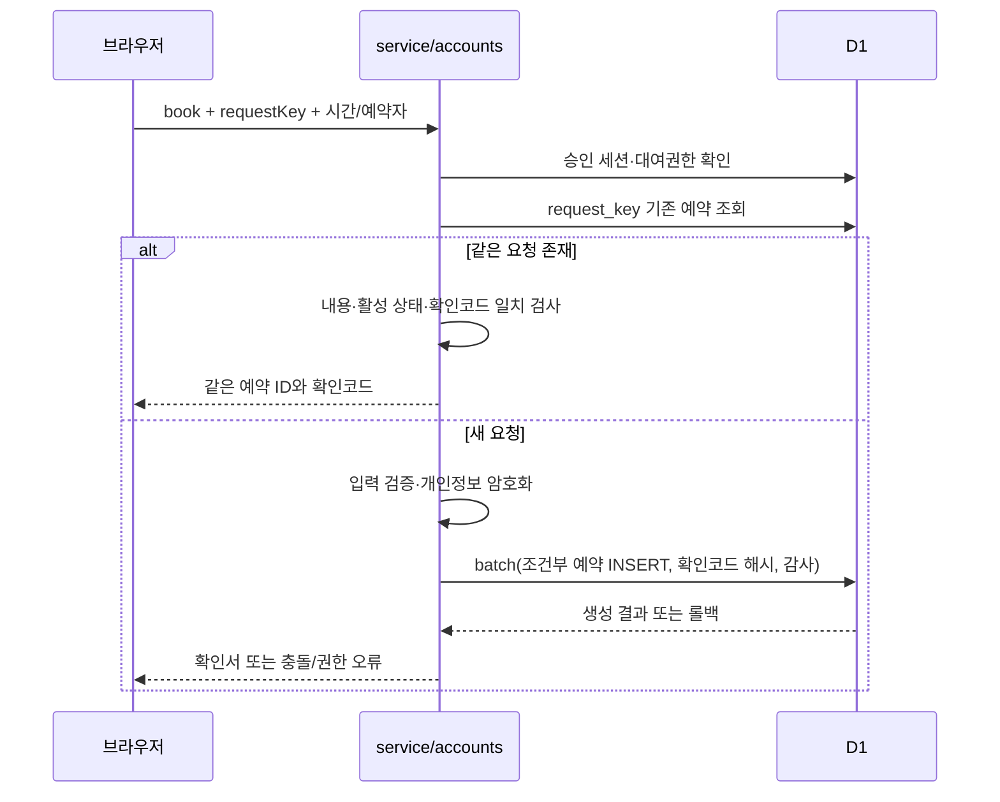

# API와 데이터 흐름

## 요청 계약

Worker가 받는 업무 API는 `/api/system` 하나입니다. `GET /api/system?op=...`는 쿼리 매개변수, `POST /api/system`은 `{ "op": "...", ... }` JSON 객체를 사용합니다. 다른 `/api/*` 경로는 404, GET·POST 이외 메서드는 405와 `Allow: GET, POST`를 반환합니다. 단일 경로 안에서도 각 연산의 허용 메서드와 권한을 다시 확인합니다.

일반 POST 본문은 실제 스트림 바이트 기준 30,000바이트까지 읽습니다. 이미지가 포함되는 `saveSiteContent`는 1,700,000바이트, `saveCatalogEntry`는 300,000바이트입니다. 이 두 연산은 URL에도 `?op=...`가 있어야 하며 관리자 확인 후 큰 본문을 읽고 본문 `op`와 일치하는지 확인합니다. 클라이언트의 [requestJson](../../src/api-client.mjs)이 이 형식을 구성합니다.

POST는 `Content-Type: application/json`을 요구하고 배열·원시값을 거절합니다. `Sec-Fetch-Site: cross-site` 또는 현재 URL과 다른 `Origin`도 거절합니다. Origin이 없는 요청 자체를 곧 권한 있는 요청으로 취급하지는 않으며, 이후 각 연산의 서버 세션 검사가 필요합니다. 구현은 [service.mjs](../../lib/service.mjs), 경계 검사는 [api-client.test.mjs](../../tests/api-client.test.mjs), [security-hardening.test.mjs](../../tests/security-hardening.test.mjs), [reservation-read.test.mjs](../../tests/reservation-read.test.mjs)를 참고하세요.

## 서버 처리 순서

1. Worker가 비공개 사이트 접근 암호, API 경로·메서드, DB·키 형식을 검사합니다.
2. `handleApi`가 본문·출처를 검증하고 `op`를 추출합니다.
3. `serverTime` 및 관리자 인증 연산을 먼저 처리합니다.
4. `privacy_state.ready=1`이 아니면 `setup`을 제외한 나머지 업무 API는 503으로 멈춥니다.
5. 예약 조회 → 사이트 콘텐츠 → 카탈로그 → 평면도 → 예약 오픈 → 동아리 계정 → 데이터 관리 모듈 순으로 전달합니다.
6. 공용 날짜 조회·동아리 예약을 처리한 뒤, 나머지 관리자 예약·동아리·벌점 API 전에 관리자 인증을 요구합니다.
7. 오류는 JSON `{error, scope?}`로 반환합니다. SQLite·D1·암호화 내부 오류를 원문으로 노출하지 않습니다.

`json()` 응답의 기본값은 `Cache-Control: no-store`입니다. API 이미지 응답의 조건부 캐시 등은 해당 모듈의 별도 정책을 확인해야 합니다. Worker는 API 응답에 HSTS·프레이밍 차단 등 공통 헤더를 덧붙입니다.

## 연산 지도

아래 표는 라우팅과 접근 범위를 빠르게 찾기 위한 지도입니다. 필수 필드·허용 값·실제 응답의 최종 기준은 연결된 모듈입니다. “공용”은 앱 계정이 필요 없다는 뜻이며, 비공개 배포의 사이트 접근 암호와 개인정보 전환 게이트는 적용됩니다.

| 영역 | 주요 연산 | 권한·소스 |
| --- | --- | --- |
| 시각·첫 화면 | `serverTime`, `day` | 공용, [service](../../lib/service.mjs) |
| 관리자 인증 | `auth`, `setup`, `login`, `mfaVerify`, `logout`, `adminActivity`, `credentials`, `mfaStatus`, `mfaRotateStart`, `mfaRotateComplete`, `mfaRecoveryReset` | 최초 설정 키/로그인 단계/MFA별 검사, [admin-auth](../../lib/admin-auth.mjs)·[service](../../lib/service.mjs) |
| 가입·동아리 로그인 | `registrationClubs`, `clubSignup`, `clubLogin`, `clubSession`, `clubLogout` | 공용 진입 및 자신의 세션, [accounts](../../lib/accounts.mjs) |
| 내 동아리 | `clubHeartbeat`, `clubCredentials`, `myClub` | 로그인/승인 조건은 연산별 상이, [accounts](../../lib/accounts.mjs) |
| 장소대여 | `myBookings`, `book`, `lookup`, `cancel`, `myReceipt` | 승인된 동아리+대여 임대, 관리자 `force` 예약은 관리자 세션, [accounts](../../lib/accounts.mjs)·[service](../../lib/service.mjs) |
| 조회 전용 | `readerLogin`, `readerLogout`, `readerActivity`, `shareRedeem`, `shareLogout`, `readAuth`, `reservationRead`, `reservationTable` | reader/share 쿠키 또는 main 관리자, [reservation-read](../../lib/reservation-read.mjs) |
| 조회 권한 관리 | `readAccess`, `saveReader`, `createReadLink`, `revokeReadLink` | 관리자; 계정 저장·링크 발급은 재인증, [reservation-read](../../lib/reservation-read.mjs) |
| 동아리·계정 | `clubs`, `saveClub`, `secret`, `accountSave`, `accountDelete`, `accountSecret` | 관리자; 방 비밀번호 보기·비밀번호 설정·계정 삭제는 재인증, 원문 계정 비밀번호 조회는 410, [service](../../lib/service.mjs)·[accounts](../../lib/accounts.mjs) |
| 관리자 예약·벌점 | `dashboard`, `openings`, `event`, `bookingAction`, `penalties`, `savePenalty`, `voidPenalty`, `export` | 관리자, [service](../../lib/service.mjs) |
| 예약 오픈 | `scheduledOpenings`, `scheduleOpenings`, `cancelOpeningSchedule` | 관리자, [scheduled-openings](../../lib/scheduled-openings.mjs) |
| 사이트 콘텐츠 | `siteContent`, `siteImage`, `saveSiteContent` | 읽기 공용/저장 관리자, [site-content](../../lib/site-content.mjs) |
| 안내·장비·게시판 | `catalog`, `entryImage`, `saveCatalogEntry`, `deleteCatalogEntry`, `moveCatalogEntry` | 공개 항목 읽기/관리자 편집, [catalog](../../lib/catalog.mjs) |
| 평면도 | `floorplan`, `saveRoomAssignment` | 관리자, [club-rooms](../../lib/club-rooms.mjs) |
| 데이터 관리 | `dataOverview`, `prepareDataAction`, `dataJob`, `dataExport`, `executeDataAction` | 관리자, 실행 시 재인증/확인 조건, [data-management](../../lib/data-management.mjs) |
| 사용량 연결 | `metricsLink`, `saveMetricsLink`, `removeMetricsLink`, `cloudUsage` | 관리자, 연결 변경 재인증, [data-metrics](../../lib/data-metrics.mjs) |

## 예약 생성과 재시도

활성 예약은 `APPROVED`, `OVERRIDE`입니다. 일반 예약은 장소 오픈·시작 전 시간·규정 동의·점검 동의·금요일/주말/공휴일 동아리별 하루 총 4시간 조건을 검사합니다. 관리자 추가승인은 일부 이용 제한을 우회하지만 다른 활성 예약과의 시간 겹침을 허용하지 않습니다. 시작·종료는 분 단위 정수이고 선택 가능한 슬롯의 연결성은 [rules.mjs](../../lib/rules.mjs)가 검증합니다.

서버는 `BOOKING_KEY`와 `request_key`의 HMAC으로 확인코드를 재현하고 `booking_access`에는 코드의 SHA-256만 저장합니다. `lookup`과 구형 확인정보를 포함한 `cancel`도 로그인한 동아리에 한정됩니다. `myReceipt`는 자신의 활성 예약과 현재 대여권한을 검사합니다. 네트워크 실패 후 같은 요청 재시도가 중복 예약으로 이어지지 않는지는 [system.test.mjs](../../tests/system.test.mjs), [security-hardening.test.mjs](../../tests/security-hardening.test.mjs)에서 검사합니다.

## 개인정보가 화면에 전달되는 범위

공용 `day`는 장소·시작·종료의 점유 정보와 활성 동아리 기본 목록을 반환합니다. 조회 전용 `reservationRead`/`reservationTable`은 날짜·장소·시작·종료·동아리명·상태만 선택합니다. 관리자 `dashboard`는 예약자·전화번호 등 암호화된 운영 필드를 복호화하여 반환합니다. 동아리의 개인 예약 조회도 자신의 동아리에 묶입니다. 공유 링크는 서버에서 날짜와 장소를 추가 제한하며 요청 파라미터 변경으로 범위를 넓힐 수 없습니다.

목록은 용도에 따라 페이지/상한을 갖습니다. 관리자 `dashboard`는 1,001건을 읽어 1,000건과 `truncated`를 반환합니다. 조회 전용 목록은 페이지당 100건, 하루 시간표는 최대 2,000건과 초과 표시를 반환합니다. 데이터 내보내기는 페이지당 200건입니다. 이것은 코드의 응답 정책이며 Cloudflare 서비스의 현재 요금제 한도를 뜻하지 않습니다.

데이터 내보내기·학기 마감·영구 삭제 흐름과 두 CSV 경로의 차이는 [데이터 관리](../05-database/data-management.md), 인증별 쿠키·만료·재인증은 [인증과 보안](authentication-and-security.md)을 참고하세요.
