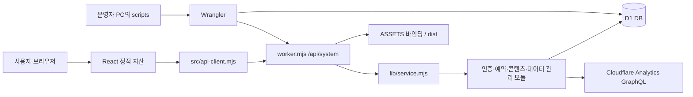

# 시스템 개요

이 서비스는 동아리의 장소 예약·확인서·예약 이력, 동아리 및 계정 관리, 벌점·학기 마감, 안내 콘텐츠·평면도, 예약 조회 전용 권한을 하나의 웹 애플리케이션으로 운영합니다. 배포 단위는 정적 자산과 Worker이며 업무 데이터와 이미지 변경분은 D1에 저장합니다.

## 실행 구조

비공개 설정에서는 Worker의 사이트 접근 암호 검사가 자산과 API보다 먼저 실행됩니다. 공개 설정에서는 자산을 제공하고 `/api/*`를 Worker에서 처리합니다. 이는 앱의 관리자 로그인과 독립적인 배포 공개 범위입니다. [worker.mjs](../../worker.mjs), [wrangler.example.json](../../wrangler.example.json), [hosting.mjs](../../scripts/hosting.mjs)에 해당 분기가 있습니다.

## 주요 구성요소와 책임

| 위치 | 책임 |
| --- | --- |
| [src/](../../src/) | React 화면, 입력·상태·세션 만료 표시, 시간표와 내보내기 화면 |
| [src/api-client.mjs](../../src/api-client.mjs) | 같은 출처 API 호출, 기본 20초 제한, 401 세션 만료·423 대여권한 이벤트 |
| [worker.mjs](../../worker.mjs) | 비공개 접근 게이트, API 경로·메서드·서버 설정 검사, 응답 헤더, 정적 자산 전달 |
| [lib/service.mjs](../../lib/service.mjs) | 요청 본문 검사, 모듈 조립, 공통 SQL·감사·제한 처리, 예약·벌점 업무 |
| [lib/admin-auth.mjs](../../lib/admin-auth.mjs) | 관리자 최초 설정 이후 로그인·MFA·재인증·세션 |
| [lib/accounts.mjs](../../lib/accounts.mjs) | 동아리 가입·승인·다중 로그인과 독점 대여권한 |
| [lib/reservation-read.mjs](../../lib/reservation-read.mjs) | 조회 전용 계정, 범위 제한 공유 링크, 최소 정보 예약 조회 |
| [lib/privacy.mjs](../../lib/privacy.mjs), [lib/security.mjs](../../lib/security.mjs) | 개인정보 봉인·복호화, 해시·HMAC·AES-GCM |
| [lib/site-content.mjs](../../lib/site-content.mjs), [lib/catalog.mjs](../../lib/catalog.mjs) | 사이트 설정·브랜딩 이미지·안내/장비/게시판 콘텐츠 |
| [lib/club-rooms.mjs](../../lib/club-rooms.mjs), [lib/club-profile.mjs](../../lib/club-profile.mjs) | 방 배정·평면도와 동아리 분류·연락처 검증 |
| [lib/opening-time.mjs](../../lib/opening-time.mjs), [lib/scheduled-openings.mjs](../../lib/scheduled-openings.mjs) | 수동/예약 오픈 상태와 서버 시각 기준 판정 |
| [lib/data-management.mjs](../../lib/data-management.mjs), [lib/data-export.mjs](../../lib/data-export.mjs) | 페이지 내보내기, 학기 마감, 영구 정리 작업 |
| [lib/data-metrics.mjs](../../lib/data-metrics.mjs) | 선택적 외부 사용량 조회와 암호화된 조회 토큰 보관 |
| [migrations/](../../migrations/) | D1 스키마 0001~0012 |
| [scripts/](../../scripts/) | 배포 준비·업데이트·백업·암호화 전환·로컬 런타임 검증 |

## 데이터와 업무 경계

`clubs`의 식별자는 이름 변경과 독립적입니다. `club_accounts`는 동아리별 하나의 계정을 연결하고, 여러 브라우저의 로그인은 `club_sessions`로 분리합니다. 예약·벌점은 동아리 ID를 참조하므로 이름·방 수정으로 과거 연결이 끊기지 않습니다. 동아리방 비밀번호와 웹 계정 비밀번호는 용도가 다릅니다. 전자는 관리자 재인증 후 복호화할 수 있고 후자는 해시만 저장하여 원문 조회가 없습니다.

승인된 동아리 계정으로 여러 기기에서 내 동아리 정보를 읽을 수 있습니다. 장소대여 작업에는 추가로 `club_rental_leases`의 한 명 소유권이 필요합니다. 로그인 만료 8시간과 대여 임대 만료 3분을 분리하여 한 화면의 끊김이 계정 전체 로그아웃으로 이어지지 않도록 구성했습니다. 세부 조건은 [인증과 보안](authentication-and-security.md)에 있습니다.

사진 제출 기능은 `bookings.entry_photo`와 `exit_photo` 확인값을 변경합니다. 예약 사진 원본을 저장하는 별도 테이블은 없습니다. 사이트·게시물 이미지는 `site_images`와 `content_entries.data`에 보관하므로 이들과 사진 확인값을 혼동하지 마세요.

예약 오픈 예정 시각은 서버 시계와 SQL 조건으로 평가합니다. 시각 도달 시 별도 cron이 `openings`를 갱신하는 구조가 아닙니다. 수동 오픈과 예약 오픈의 조합은 [opening-time.mjs](../../lib/opening-time.mjs), [scheduled-openings.test.mjs](../../tests/scheduled-openings.test.mjs)에서 확인할 수 있습니다.

## 동시성과 일관성

예약 충돌 검사는 클라이언트 화면의 비활성 표시만으로 보장하지 않습니다. `service.mjs`의 한 `INSERT ... SELECT ... WHERE`가 세션/대여권한, 장소 오픈, 겹치는 활성 예약, 이용 제한을 함께 검사합니다. 예약·확인코드·감사 기록은 `db.batch`에 묶습니다. `request_key`의 고유 제약과 같은 요청의 내용 비교는 재시도 시 같은 예약·확인서를 돌려주고 내용이 달라진 재사용을 거절합니다.

관리자 권한, 동아리 계정 버전, 평면도·프로필·콘텐츠 버전 등은 실제 쓰기 SQL에도 조건으로 들어갑니다. 인증 직후 권한이 취소되거나 다른 화면이 저장한 경우 오래된 요청이 그대로 쓰이지 않도록 합니다. 실패한 감사 기록과 업무 변경은 같은 배치에서 함께 롤백하도록 테스트합니다. 원자적 배치 검증의 근거는 [system.test.mjs](../../tests/system.test.mjs), [security-hardening.test.mjs](../../tests/security-hardening.test.mjs), [club-profile.test.mjs](../../tests/club-profile.test.mjs), [catalog-rooms.test.mjs](../../tests/catalog-rooms.test.mjs)입니다.

이 문서는 소스 구조와 테스트가 다루는 계약을 설명합니다. 로컬 SQLite 어댑터 테스트, Miniflare의 Worker+D1 런타임 검사, 실제 Cloudflare 운영 검증은 서로 다른 증거입니다. 실행 절차와 확인 범위는 [배포와 운영](deployment-and-operations.md), 물리 관계는 [스키마](../05-database/schema-and-relations.md)를 참고하세요.
